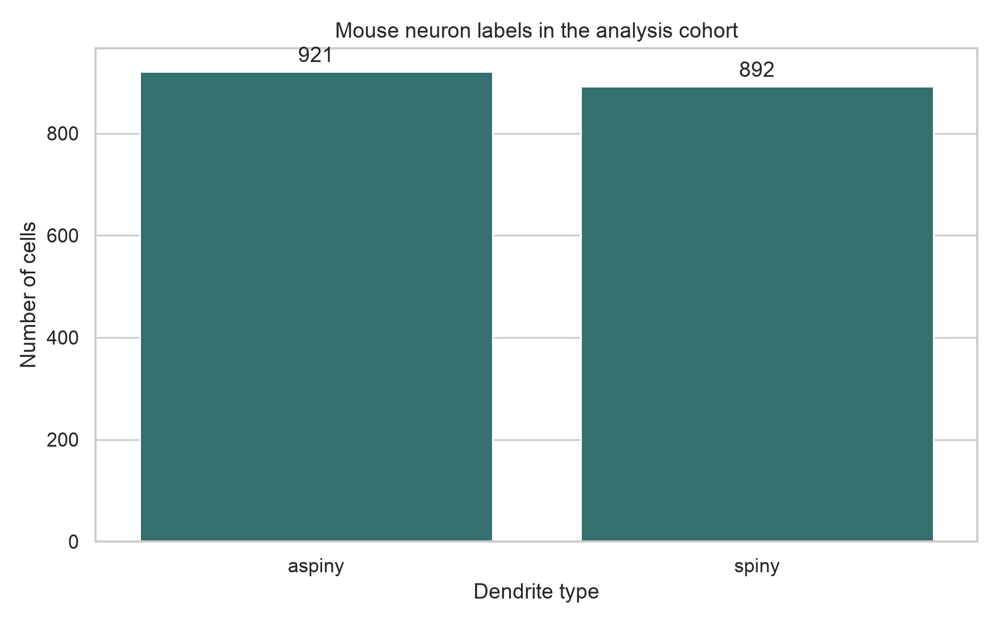
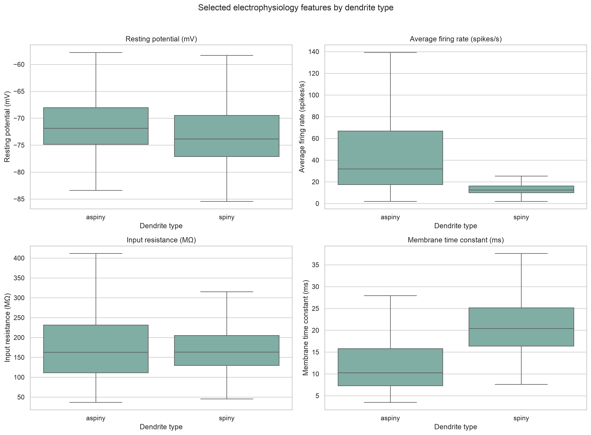
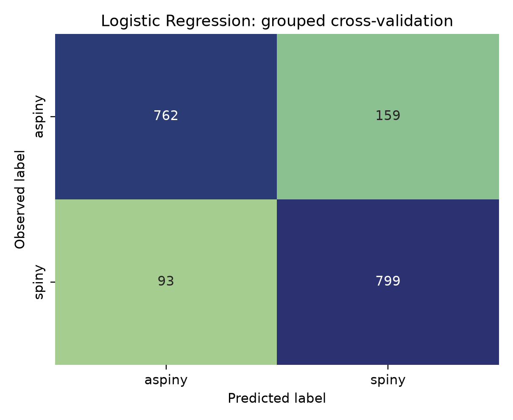
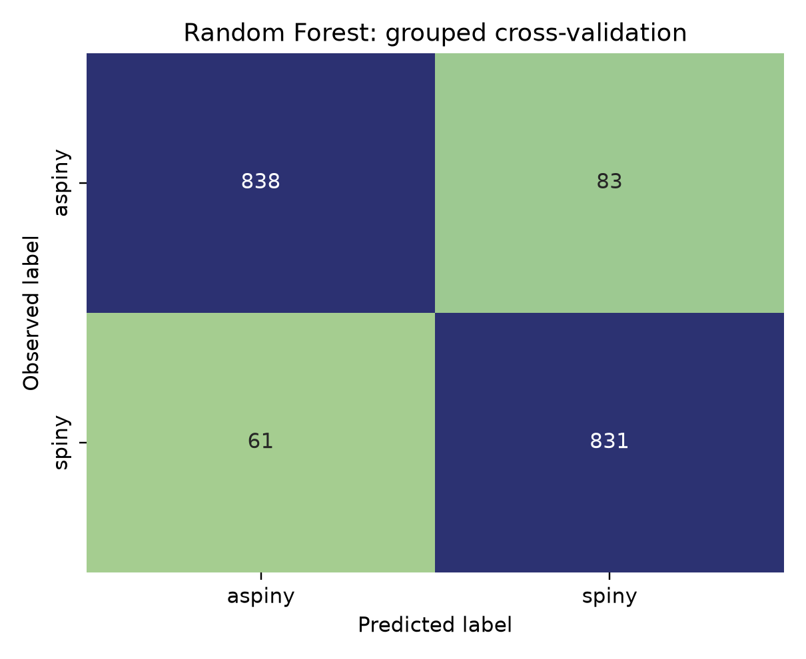

# Can Electrophysiological Features Distinguish Spiny and Aspiny Mouse Neurons? A Machine Learning Analysis of the Allen Cell Types Database

**Yuxuan Zhu**

## Abstract

Neurons are characterized by morphology and electrical behavior, but the ability of electrophysiology features to distinguish spiny from aspiny labels is unclear. We analyzed 1,813 mouse cells from the Allen Cell Types Database, using 11 precomputed features. Logistic Regression and Random Forest were evaluated with five-fold cross-validation grouped by mouse line. Random Forest achieved accuracy of 0.921 and ROC-AUC of 0.977. Results show predictive signal but require interpretation because dataset composition and labels limit conclusions.

## Introduction

Neurons can be characterized through multiple cellular properties, including their electrical responses and dendritic morphology. The Allen Cell Types Database makes single-cell electrophysiology and other cell-level measurements available for mouse and human brain samples.[1] The database also records dendrite type, including spiny, aspiny, and sparsely spiny annotations, alongside computed electrophysiological features.[2]

This project examines whether a limited set of precomputed electrophysiological measurements can distinguish mouse cells annotated as spiny from those annotated as aspiny. The objective is to compare a linear baseline model with a tree-based classifier and to evaluate performance on mouse lines excluded from model training. The analysis is exploratory: it evaluates prediction of existing database annotations and does not test whether electrophysiology causes morphology or whether a classifier has clinical utility.

## Methods

### Study design and setting

This was a retrospective secondary analysis of public, single-cell experimental data from the Allen Cell Types Database. Data were retrieved programmatically from the Allen Brain Map API on November 19, 2026. No patient-level clinical records were used.

### Dataset and study cohort

The metadata query returned 1,920 mouse cell records. A separate query returned 2,333 computed electrophysiology feature records across species. The tables were joined by specimen identifier. The binary analysis included cells with an electrophysiology record and a dendrite-type annotation of either `aspiny` or `spiny`. The 107 cells annotated as `sparsely spiny` were excluded from the primary analysis. The final cohort contained 1,813 cells: 921 aspiny and 892 spiny.

### Predictors and outcome

The outcome was dendrite type (`aspiny` or `spiny`). Eleven precomputed electrophysiology predictors were selected: resting membrane potential, average firing rate, input resistance, membrane time constant, adaptation index, average interspike interval, F-I curve slope, fast action-potential trough, ramp spike time, threshold current, and the action-potential upstroke-to-downstroke ratio. These features are among the measurements provided for cell-level records in the Allen database.[2] Morphology measurements, dendrite labels, specimen identifiers, mouse line, and other metadata were not used as predictors.

### Data preparation and statistical analysis

Candidate features were inspected for missingness and compared descriptively by dendrite type. Median imputation was applied within each training fold. Logistic Regression used standardized predictors. Random Forest used 400 trees, a minimum leaf size of three, and balanced subsampling of classes. No hyperparameter search was performed.

Model evaluation used five-fold StratifiedGroupKFold cross-validation, with mouse line as the grouping variable. This design kept cells from the same mouse line together within each fold, so no line appeared in both the training and test sets for that fold. Performance was summarized from pooled out-of-fold predictions using accuracy, balanced accuracy, precision, recall, F1 score, and ROC-AUC. Random Forest is an ensemble method based on multiple decision trees.[3] Analyses were implemented in Python using scikit-learn.[4]

## Results

### Cohort characteristics and data quality

The primary cohort was nearly balanced by outcome: 921 cells (50.8%) were aspiny and 892 (49.2%) were spiny. It represented 37 mouse lines; 19 lines contained both outcome labels, while 18 contained only one. Among the 11 candidate predictors, missingness was highest for adaptation index (11.6%), followed by average firing rate and average interspike interval (5.4% each) and ramp spike time (3.2%). The other seven features had no missing values in the analysis cohort.

### Classification performance

Random Forest had higher pooled out-of-fold performance than Logistic Regression. Random Forest achieved accuracy 0.921, balanced accuracy 0.921, precision 0.909, recall 0.932, F1 score 0.920, and ROC-AUC 0.977. Logistic Regression achieved accuracy 0.861, balanced accuracy 0.862, precision 0.834, recall 0.896, F1 score 0.864, and ROC-AUC 0.935. Figure 1 shows the cohort class counts; Figure 2 displays selected electrophysiology features by dendrite type. Confusion matrices are provided for both models.

| Model | Accuracy | Balanced accuracy | Precision (spiny) | Recall (spiny) | F1 (spiny) | ROC-AUC |
|---|---:|---:|---:|---:|---:|---:|
| Logistic Regression | 0.861 | 0.862 | 0.834 | 0.896 | 0.864 | 0.935 |
| Random Forest | 0.921 | 0.921 | 0.909 | 0.932 | 0.920 | 0.977 |

## Discussion and Conclusion

In this dataset, electrophysiological features contained information that helped distinguish Allen database annotations of aspiny and spiny mouse cells. Under validation grouped by mouse line, Random Forest performed better than Logistic Regression across the reported pooled metrics. This result supports the use of a nonlinear classifier for this exploratory prediction task, while the comparison does not establish why the model performed better.

The grouped validation design addresses an important source of overly optimistic evaluation: the same mouse line is not shared between training and test data within a fold. Even so, the cohort is not independent of mouse-line composition. Eighteen of 37 lines contained only one outcome label, so line, cell biology, and label distribution may remain related. The model may therefore be learning patterns that reflect the Allen sample and line composition, even though line itself was excluded as a predictor.

Other limitations include the use of a single public database, exclusion of sparsely spiny cells, lack of external validation, and reliance on existing dendrite annotations. The results should not be interpreted as causal evidence, a definitive neuron taxonomy, or evidence of clinical use. Future work could evaluate the model on an independently collected dataset, examine performance across brain regions, and assess which electrophysiology features contribute consistently across mouse lines.

In conclusion, the Random Forest model distinguished spiny and aspiny labels with pooled out-of-fold accuracy of 0.921 and ROC-AUC of 0.977 under grouped cross-validation. The findings suggest that electrophysiology-based classification is feasible in this dataset, but conclusions should remain limited to these sampled mouse cells and annotations.

## References

1. Allen Institute for Brain Science. Allen Cell Types Database. Accessed November 19, 2026. https://celltypes.brain-map.org/.
2. Allen Institute for Brain Science. Cell Types Database API. Allen Brain Map. Accessed November 19, 2026. https://brain-map.org/support/documentation/cell-types-database-api.
3. Breiman L. Random forests. Mach Learn. 2001;45:5-32. doi:10.1023/A:1010933404324.
4. Pedregosa F, Varoquaux G, Gramfort A, et al. Scikit-learn: machine learning in Python. J Mach Learn Res. 2011;12:2825-2830.

## GitHub repository

GitHub repository: **https://github.com/canoki1717/CHIP705-FinalProject**

## Figure legends

**Figure 1.** Number of cells by dendrite-type annotation in the primary binary analysis cohort.

**Figure 2.** Distributions of resting potential, average firing rate, input resistance, and membrane time constant by dendrite type. Boxes show the interquartile range and median; whiskers exclude outliers for readability.

**Figure 3.** Confusion matrix for Logistic Regression using pooled out-of-fold predictions from five-fold validation grouped by mouse line.

**Figure 4.** Confusion matrix for Random Forest using pooled out-of-fold predictions from five-fold validation grouped by mouse line.
